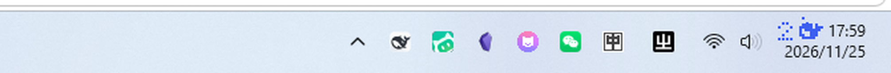
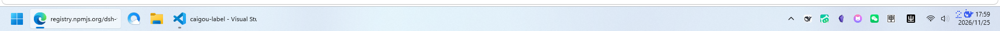

# dsh-taskbar-lamp

Windows 任务栏上的一只像素鲸鱼，旁边是此刻正在干活的 dsh 会话数。





- **实时数字**：每个正在跑的 dsh 会话算一个；子代理不算，它们算在父会话里。
- **变红闪动**：有弹窗等你确认（问你选哪个、或者要权限）时，数字变红并闪动。
- **翻牌**：任务数变多时向上翻、变少时向下翻。
- **吐泡泡**：有会话在跑时，鲸鱼会慢慢吐泡泡。
- **记住位置**：可以沿任务栏拖动，纵向只在任务栏那一条里挪。

只读 `%USERPROFILE%\.dsh\sessions\` 下 dsh 自己写的会话文件，不外传任何数据。

## 安装

```sh
dsh plugin add dsh-taskbar-lamp
```

插件随 dsh 启动，dsh 退出时一起关掉。

## 环境要求

- Windows 10 或 11（Windows 11 摆放更整齐）。
- Python 3.10 以上，并装有 `pillow`、`pystray`、`zstandard`：

```sh
python -m pip install pillow pystray zstandard
```

- 插件按这个顺序找解释器：配置里的 `pythonPath`、环境变量 `DSH_LAMP_PYTHON`、`D:\develop\python313\pythonw.exe` / `C:\Python313\pythonw.exe`、`PATH` 里的 `pythonw`。

## 已知限制

- 只在 Windows 上工作。
- 灯只在 dsh 运行期间存在。
- 只告诉你“有东西在等你”，不告诉你是哪个项目。

## English

A small pixel whale on the Windows taskbar that tells you how many DeepSeek Harness (dsh) sessions are working right now.

- **Live count** — every running dsh session counts one; subagents count toward their parent session.
- **Red and blinking** — a session is waiting for you: a question dialog, or an approval prompt.
- **Rolling digits** — the number rolls up when work appears and down when it finishes.
- **Bubbles** — the whale blows slow bubbles while at least one session is working.
- **Remembers where you put it** — drag it along the taskbar.

It reads nothing but the session files dsh already writes under `%USERPROFILE%\.dsh\sessions\`. Nothing leaves your machine.

## Install

```sh
dsh plugin add dsh-taskbar-lamp
```

The plugin starts the lamp with dsh and stops it when dsh exits.

## Requirements

- Windows 10 or 11.
- Python 3.10+ with `pillow`, `pystray` and `zstandard`.
- The plugin finds the interpreter through the `pythonPath` option, `DSH_LAMP_PYTHON`, the bundled fallbacks, or `pythonw` on `PATH`.

## Limits

- Windows only.
- The lamp lives as long as dsh does.
- It tells you *that* something is waiting, not which project.

## License

MIT
